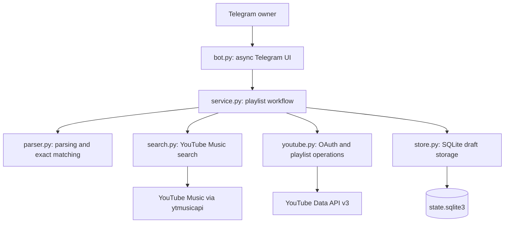

# Personal YouTube Music Playlist Bot

## Project Description

A Telegram bot that accepts a list in `Artist — Song` format (one entry per line), searches YouTube Music, and creates a **private** playlist in your Google account. It runs on your Windows PC while the long-polling process is active, either locally or through Docker Compose. Search uses the unofficial `ytmusicapi`; playlist creation and track insertion use the official YouTube Data API.

The project is designed for personal use by a single Telegram owner in a private chat. It supports recording selection, custom search queries, skipping tracks, a playlist title, and a review of the selected recordings before creation. A saved draft allows the owner to continue after a restart or an external service error using `/resume`.

## Architecture

The application runs as a single process with separate layers for Telegram interaction, workflow rules, external services, and persistence. `__main__.py` reads configuration and connects these components for the `bot` command; the `auth` command performs local Google OAuth authorization.



`bot.py` handles commands, messages, inline buttons, and owner access checks. It serializes workflow actions with an `asyncio.Lock` and runs synchronous workflow operations in worker threads with `asyncio.to_thread`. `service.py` coordinates parsing, searches, selections, playlist creation, insertion, and recovery independently of Telegram presentation.

`search.py` performs unauthenticated song searches and converts results into shared models. `youtube.py` manages OAuth credentials and official API calls. `store.py` saves a single draft as JSON in a SQLite row, with each save committed in a transaction. `models.py` defines the draft, track, and candidate dataclasses; `config.py` supplies environment configuration and runtime paths.

## Approach

The workflow follows a persisted sequence: `resolving` → `title` → `confirm` → `creating` → `writing` → `done`.

1. **Parse the input.** Accept one artist/title pair per line, including common numbering and dash separators. Report invalid line numbers before starting a draft.
2. **Resolve recordings conservatively.** Match the normalized artist and base title exactly, then compare recording versions. An ordinary request prefers a studio recording over explicitly labelled live, acoustic, remix, instrumental, radio edit, extended, remastered, rerecorded, clean, or explicit versions. A requested version retains its identifying venue, year, or remix name. One compatible result is selected automatically; several studio releases are selected automatically only when their complete artist credits match and every duration is valid and positive, with a total spread of at most two seconds. Several matches for an explicitly requested version, unclear/conflicting version labels, missing durations among multiple studio releases, different credits, or longer duration differences require the owner's choice. All search results participate in the decision; relevant results are ranked before the first five options are shown. A custom search always requires manual selection and keeps the search order.
3. **Review before writing.** Ask for a playlist title and show the selected recordings, including album and duration when available, before the owner confirms creation.
4. **Create and populate the playlist.** Create a private playlist, save its ID, and insert selected recordings in input order. Repeated video IDs are skipped. Before the first insertion attempt, wait for playlist availability and retry only `404 playlistNotFound` reads, up to three attempts.
5. **Recover through reconciliation.** Persist creation and insertion attempts before sending writes. On `/resume`, identify an uncertain playlist creation by its draft marker and compare remote playlist contents with the expected track order before continuing. An absent track after an uncertain insertion requires an explicit retry after the owner checks the playlist; unexpected external changes stop writing.

The application keeps one active draft, validates buttons against draft IDs and search or insertion revisions, and allows cancellation before creation starts. Automated tests use fake external services and temporary storage so that workflow recovery can be checked without network access or credentials.

## Folder Structure

```text
ym_playlist_maker/
├── README.md                    # Project documentation and operating instructions
├── pyproject.toml               # Package metadata, dependencies, and pytest settings
├── Dockerfile                   # Python 3.12 container image
├── compose.yaml                 # Bot service, environment, and data bind mount
├── .env.example                 # Example Telegram configuration
├── .gitignore                   # Local state, secrets, and generated file exclusions
├── .dockerignore                # Container build context exclusions
├── AGENTS.md                    # Local repository guidelines
├── plan.md                      # Current task record, while a task is open
├── src/
│   └── ym_playlist_maker/
│       ├── __init__.py           # Package initialization
│       ├── __main__.py           # auth and bot CLI entry points
│       ├── bot.py                # Telegram commands, messages, and inline buttons
│       ├── config.py             # Environment configuration and data directory
│       ├── models.py             # Draft, track, and search candidate models
│       ├── parser.py             # Track list parsing and normalized exact matching
│       ├── search.py             # YouTube Music search adapter
│       ├── service.py            # Playlist workflow and recovery rules
│       ├── store.py              # SQLite draft persistence
│       └── youtube.py            # Google OAuth and YouTube Data API adapter
├── tests/
│   ├── test_auth.py              # OAuth configuration, callback, and token storage
│   ├── test_boundaries.py        # API requests and Telegram interaction boundaries
│   ├── test_parser.py            # Input parsing and matching rules
│   └── test_workflow.py          # State transitions, retries, and write reconciliation
├── docs/
│   └── archive_tasks/            # Local records of project tasks
└── data/                        # Docker runtime token and SQLite state
```

`AGENTS.md`, `plan.md`, and `docs/` are local working records excluded from Git. The runtime `data/` directory is also excluded from Git and the Docker build context. Local execution defaults to `%LOCALAPPDATA%\ym_playlist_maker`; `YM_DATA_DIR` overrides the runtime location. OAuth client files are supplied separately from a private location.

## Technical Stack

The dependency ranges below are declared in `pyproject.toml`; the Docker image uses Python 3.12.

| Area               | Technology                 | Version or configuration                                                 |
|--------------------|----------------------------|--------------------------------------------------------------------------|
| Runtime            | Python                     | `>=3.12`                                                                 |
| Telegram interface | `python-telegram-bot`      | `>=22.0,<23`; asynchronous handlers and long polling                     |
| Music search       | `ytmusicapi`               | `>=1.10,<2`; unauthenticated YouTube Music song search                   |
| Playlist API       | `google-api-python-client` | `>=2.0,<3`; YouTube Data API v3                                          |
| Authorization      | `google-auth-oauthlib`     | `>=1.3,<2`; Google OAuth Desktop app flow and locally stored credentials |
| Persistence        | SQLite and JSON            | Python standard library `sqlite3` and `json`                             |
| Concurrency        | `asyncio`                  | Python standard library; serialized actions and worker threads           |
| Packaging          | setuptools and pip         | `setuptools>=70`; `src/` package layout and editable installation        |
| Testing            | pytest                     | `>=8,<10`; optional `test` dependency group                              |
| Deployment         | Docker and Docker Compose  | `python:3.12-slim`; one bot service with a persistent data bind mount    |

## Setup

1. Install Python 3.12 and create a bot through `@BotFather`. Save the bot token and the owner's **numeric** Telegram user ID. The bot only accepts messages from this ID in a private chat.
2. In [Google Cloud Console](https://console.cloud.google.com/), create a project, enable **YouTube Data API v3**, configure the OAuth consent screen, and create an OAuth client of type **Desktop app**. Download the client JSON to a private location outside the repository. Add your Google account to the test users if the OAuth app is in Testing mode.
3. To run without Docker, open PowerShell in the project directory:

   ```powershell
   py -3.12 -m venv .venv
   .\.venv\Scripts\python.exe -m pip install -e ".[test]"
   .\.venv\Scripts\python.exe -m ym_playlist_maker auth --client-secrets C:\path\to\desktop-client.json
   $env:TELEGRAM_BOT_TOKEN = "token-from-BotFather"
   $env:TELEGRAM_OWNER_ID = "your-numeric-id"
   .\.venv\Scripts\python.exe -m ym_playlist_maker bot
   ```

   The `auth` command opens your default browser and saves the Google OAuth token to `%LOCALAPPDATA%\ym_playlist_maker\token.json`. The bot also stores `state.sqlite3` there. These files contain sensitive data: restrict directory access to your Windows user and do not copy the token into the repository. To use a different directory, set `YM_DATA_DIR` before running both commands.

4. Send the bot a list, for example:

   ```text
   Oasis — Wonderwall
   Linkin Park — Numb
   Radiohead — Creep
   ```

   Confident matches are selected automatically using the recording rules above. Otherwise, the bot explains why a choice is needed and shows up to five options with title, artist, album, and duration (when available); it reports any hidden results so you can narrow the search. Before displaying the creation button, the bot sends a list of all selected recordings and versions, split across multiple messages if necessary. `/cancel` deletes the draft before writing begins; `/resume` continues after a restart or error. Existing pending search results retain their order and buttons on resume, even when the current matching rules would select them automatically.

   Search metadata cannot prove that two recordings sound identical. Version detection uses terminal title qualifiers and explicit album labels; ordinary names such as "Live Forever" and "Live Through This" are preserved. Unlabelled alternate takes, remasters, or edits may still be indistinguishable. The two-second duration rule is a conservative metadata heuristic, not an audio comparison. Check the selected recordings in the final review and verify real search behaviour with the integration procedure below.

## Running with Docker Compose

Install Docker with Compose. Complete OAuth authorization once on the Windows host: it opens a browser and uses a temporary local port. From the project directory in PowerShell:

```powershell
if (-not (Test-Path .env)) { Copy-Item .env.example .env }
notepad .env
```

Enter your actual `TELEGRAM_BOT_TOKEN` and numeric `TELEGRAM_OWNER_ID`, then save the file. Next:

```powershell
py -3.12 -m venv .venv
.\.venv\Scripts\python.exe -m pip install -e .
New-Item -ItemType Directory -Force .\data | Out-Null
$env:YM_DATA_DIR = (Resolve-Path .\data).Path
.\.venv\Scripts\python.exe -m ym_playlist_maker auth --client-secrets C:\path\to\desktop-client.json
docker compose up --build -d
docker compose logs -f bot
```

After authorization, `data/token.json` is available to the container through a bind mount; `state.sqlite3` is saved in the same directory. The `data/` directory and `.env` file are excluded from Git and the image build context. Restrict access to yourself and do not publish the output of `docker compose config`, which exposes the Telegram token. No ports need to be exposed: the bot receives messages through long polling.

If the bot has already run locally, stop the local process and copy `%LOCALAPPDATA%\ym_playlist_maker\token.json` to `data/token.json` instead of running `auth` again. If there is an unfinished draft, also move `state.sqlite3` to `data/`.

For subsequent runs, use `docker compose up -d`; stop the bot with `docker compose down`. If Google authorization needs to be renewed, run the local `auth` command with the same `YM_DATA_DIR`, then run `docker compose restart bot`.

If authorization hangs after you grant consent in Google, check whether the browser opened `http://127.0.0.1:<port>/` with a completion message. The command waits up to five minutes for this local redirect; if it does not arrive, check whether the browser, VPN, proxy, or security software is blocking the address. The `auth` command requires an OAuth client JSON of type **Desktop app**. Do not share the full redirect URL with anyone: it contains a one-time authorization code.

## Verifying the Integration Before Regular Use

Try a list of 2–3 well-known songs, check the selected versions, create a playlist, and open the returned link in **YouTube Music**. Make sure the recordings are visible and that the privacy setting and track order are correct. This combined `ytmusicapi` → official API workflow is not covered by automated tests without your credentials.

If a playlist creation or track insertion request ends without a definitive response, the bot saves its state and reconciles it with YouTube on `/resume`. If the inserted track is found, it continues without adding a duplicate. If the track is absent, the bot displays the **"I checked the playlist; retry insertion"** button. Open the playlist, confirm that the recording is absent, and only then press the button: YouTube sometimes shows changes with a delay, so retrying can still create a duplicate. If the outcome of creating *the playlist itself* is unknown, the bot will not automatically create a second one; check your playlists manually and keep `state.sqlite3` for diagnostics. An authorization or network error **before the insertion request is sent** does not require this button: fix the cause and run `/resume` again. If the quota is exhausted, run `/resume` after it resets.

An OAuth app in **Testing** mode may issue a refresh token that expires after about 7 days; run `auth` again when reauthorization is needed. For ongoing personal use, configure the OAuth app's publishing status according to Google's rules. The standard daily YouTube API quota is limited; playlist creation and each track insertion consume quota separately.

Before the first playlist contents check, the bot waits one second for the new playlist to become available. If YouTube returns `404 playlistNotFound`, it reports that the playlist is still being created and retries the check, waiting one second before each attempt (three attempts total). After the third failure, it shows the usual error; `/resume` checks the same saved playlist again without creating another one. These automatic retries apply only before any track insertion has been attempted.

## Local Tests

```powershell
.\.venv\Scripts\python.exe -m pytest -q
```

The tests do not contact Telegram or Google and do not use real secrets.
