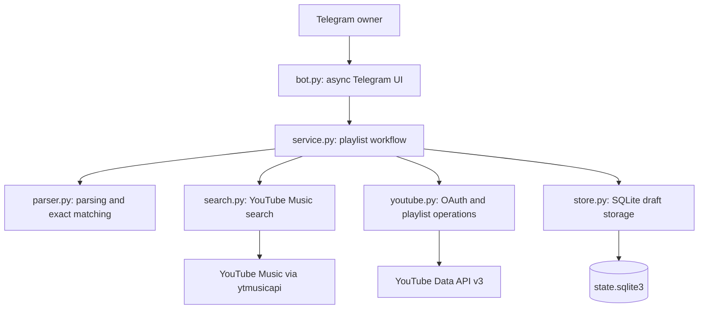

# Personal YouTube Music Playlist Bot

## Project Description

A Telegram bot that accepts a list in `Artist — Song` format (one entry per line), searches YouTube Music, and creates a **private** playlist in your Google account. It runs on your Windows PC while the long-polling process is active, either locally or through Docker Compose. Search uses the unofficial `ytmusicapi`; playlist creation and track insertion use the official YouTube Data API.

The project is designed for personal use by a single Telegram owner in a private chat. It supports recording selection, custom search queries, skipping tracks, a playlist title, and a review of the selected recordings before creation. A saved draft allows the owner to continue after a restart or an external service error using `/resume`.

Use `/language` to choose English, Russian, Spanish, German, French, or Portuguese. The selected interface language applies to messages, buttons, and the owner's command menu, and is saved independently of the playlist draft.

## Architecture

The application runs as a single process with separate layers for Telegram interaction, workflow rules, external services, and persistence. `__main__.py` reads configuration and connects these components for the `bot` command; the `auth` command performs Google OAuth authorization either locally or in a one-off container, with consent in the host browser.



`bot.py` handles commands, messages, inline buttons, and owner access checks. At startup and on `/start`, it registers the Telegram command menu for the owner's private chat. It serializes workflow actions with an `asyncio.Lock` and runs synchronous workflow operations in worker threads with `asyncio.to_thread`. `service.py` coordinates parsing, searches, selections, playlist creation, insertion, and recovery independently of Telegram presentation.

`search.py` performs unauthenticated song searches and converts results into shared models. `youtube.py` manages OAuth credentials and official API calls. `store.py` saves a single draft as JSON in a SQLite row and the owner's language preference in a separate table, with each save committed in a transaction. `i18n.py` translates Telegram presentation and saved workflow diagnostics without changing music metadata or draft contents. `models.py` defines the draft, track, and candidate dataclasses; `config.py` supplies environment configuration and runtime paths.

## Approach

The workflow follows a persisted sequence: `resolving` → `title` → `confirm` → `creating` → `writing` → `done`.

1. **Parse the input.** Accept one artist/title pair per line, including common numbering and dash separators. Report invalid line numbers before starting a draft.
2. **Resolve recordings conservatively.** Match the normalized artist credits and base title, then compare recording versions. Featuring labels such as `(feat. Sia)` are artist credits; collaborations such as `David Guetta ft. Sia` require both credited artists. Literal title text such as `Only Girl (In the World)` is preserved, and explicit studio labels identify an ordinary recording. An ordinary request prefers a studio recording over explicitly labelled live, acoustic, remix, instrumental, radio edit, extended, remastered, rerecorded, clean, or explicit versions. A requested version retains its identifying venue, year, or remix name. Unknown or conflicting candidates are excluded individually and do not block a compatible result. One compatible result is selected automatically; several studio releases are selected automatically only when their complete artist credits match and every duration is valid and positive, with a total spread of at most two seconds. Ambiguous releases are offered to optional Gemini selection, or require the owner's choice. All search results participate in the decision; relevant results are ranked before the first five options are shown. A custom search always requires manual selection and keeps the search order.
3. **Review before writing.** Ask for a playlist title and show the selected recordings, including album and duration when available, before the owner confirms creation.
4. **Create and populate the playlist.** Create a private playlist, save its ID, and insert selected recordings in input order. Repeated video IDs are skipped. Before the first insertion attempt, wait for playlist availability and retry only `404 playlistNotFound` reads, up to three attempts.
5. **Verify completion.** Read the remote playlist again before marking the draft done and require the complete expected order after duplicate skips and definitive rejections. A read failure or external change leaves the draft in writing; /resume checks it without reinserting confirmed tracks.
6. **Recover through reconciliation.** Persist creation and insertion attempts before sending writes. On `/resume`, identify an uncertain playlist creation by its draft marker and compare remote playlist contents with the expected track order before continuing. An absent track after an uncertain insertion requires an explicit retry after the owner checks the playlist; unexpected external changes stop writing.

The application keeps one active draft, validates buttons against draft IDs and search or insertion revisions, and allows cancellation before creation starts. With an optional Gemini key, fresh ambiguous searches are delegated to Gemini after local identity/version filtering; persisted decisions are never repeated after a restart. Automated tests use fake external services and temporary storage so that workflow recovery can be checked without network access or credentials.

## Folder Structure

```text
ym_playlist_maker/
├── README.md                    # Project documentation and operating instructions
├── pyproject.toml               # Package metadata, dependencies, and pytest settings
├── Dockerfile                   # Python 3.12 container image
├── compose.yaml                 # Bot service, environment, and data bind mount
├── compose.auth.yaml            # One-off OAuth service and local callback port
├── .env.example                 # Example Telegram, OAuth, and Gemini configuration
├── .gitignore                   # Local state, secrets, and generated file exclusions
├── .dockerignore                # Container build context exclusions
├── AGENTS.md                    # Local repository guidelines
├── plan.md                      # Current task record, while a task is open
├── src/
│   └── ym_playlist_maker/
│       ├── __init__.py           # Package initialization
│       ├── __main__.py           # auth and bot CLI entry points
│       ├── bot.py                # Telegram commands, messages, and inline buttons
│       ├── config.py             # Environment configuration and data directory
│       ├── i18n.py               # Interface translations for six languages
│       ├── models.py             # Draft, track, and search candidate models
│       ├── parser.py             # Track list parsing and normalized exact matching
│       ├── search.py             # YouTube Music search adapter
│       ├── selection.py          # Bounded Gemini decisions and saved-snapshot contracts
│       ├── service.py            # Playlist workflow and recovery rules
│       ├── store.py              # SQLite draft persistence
│       └── youtube.py            # Google OAuth and YouTube Data API adapter
├── tests/
│   ├── test_auth.py              # OAuth configuration, callback, and token storage
│   ├── test_boundaries.py        # API requests and Telegram interaction boundaries
│   ├── test_languages.py         # Language selection, persistence, and localized UI
│   ├── test_parser.py            # Input parsing and matching rules
│   ├── test_selection.py         # Gemini contracts, eligibility, persistence, and editing
│   └── test_workflow.py          # State transitions, retries, and write reconciliation
├── docs/
│   └── archive_tasks/            # Local records of project tasks
└── data/                        # Docker runtime token and SQLite state
```

`AGENTS.md`, `plan.md`, and `docs/` are local working records excluded from Git. The runtime `data/` directory is also excluded from Git and the Docker build context. Local execution defaults to `%LOCALAPPDATA%\ym_playlist_maker`; `YM_DATA_DIR` overrides the runtime location. OAuth client files are supplied separately from a private location.

## Technical Stack

The dependency ranges below are declared in `pyproject.toml`; the Docker image uses Python 3.12.

| Area               | Technology                 | Version or configuration                                                 |
|--------------------|----------------------------|--------------------------------------------------------------------------|
| Runtime            | Python                     | `>=3.12`                                                                 |
| Telegram interface | `python-telegram-bot`      | `>=22.0,<23`; asynchronous handlers and long polling                     |
| Music search       | `ytmusicapi`               | `>=1.10,<2`; unauthenticated YouTube Music song search                   |
| Playlist API       | `google-api-python-client` | `>=2.0,<3`; YouTube Data API v3                                          |
| Authorization      | `google-auth-oauthlib`     | `>=1.3,<2`; Google OAuth Desktop app flow with a loopback callback       |
| Persistence        | SQLite and JSON            | Python standard library `sqlite3` and `json`                             |
| Concurrency        | `asyncio`                  | Python standard library; serialized actions and worker threads           |
| Packaging          | setuptools and pip         | `setuptools>=70`; `src/` package layout and editable installation        |
| Testing            | pytest                     | `>=8,<10`; optional `test` dependency group                              |
| Deployment         | Docker and Docker Compose  | `python:3.12-slim`; bot and one-off auth share an image and data mount   |

## Setup

1. Create a bot through `@BotFather`. Save the bot token and the owner's **numeric** Telegram user ID. The bot only accepts messages from this ID in a private chat.
2. In [Google Cloud Console](https://console.cloud.google.com/), create a project, enable **YouTube Data API v3**, configure the OAuth consent screen, and create an OAuth client of type **Desktop app**. Download the client JSON to a private location outside the repository. Add your Google account to the test users if the OAuth app is in Testing mode.
3. Choose how to run the application. **Docker needs no Python installation on the computer**: follow [Running with Docker Compose](#running-with-docker-compose) for containerized preparation, authorization, and startup. For a local run without Docker, install Python 3.12 and open PowerShell in the project directory:

   ```powershell
   py -3.12 -m venv .venv
   .\.venv\Scripts\python.exe -m pip install -e ".[test]"
   .\.venv\Scripts\python.exe -m ym_playlist_maker auth --client-secrets C:\path\to\desktop-client.json
   $env:TELEGRAM_BOT_TOKEN = "token-from-BotFather"
   $env:TELEGRAM_OWNER_ID = "your-numeric-id"
   .\.venv\Scripts\python.exe -m ym_playlist_maker bot
   ```

   The `auth` command opens your default browser and saves the Google OAuth token to `%LOCALAPPDATA%\ym_playlist_maker\token.json`. The bot also stores `state.sqlite3` there. These files contain sensitive data: restrict directory access to your Windows user and do not copy the token into the repository. To use a different directory, set `YM_DATA_DIR` before running both commands.

   Local `auth` defaults to a free port on `127.0.0.1` and opens the browser automatically. `--no-browser` prints the link for you to open yourself; `--port` chooses a callback port and `--bind-address` changes the listening interface. The Google redirect address remains `127.0.0.1`. When listening on another interface, a fixed nonzero port is required.

4. Open the bot's private chat and send `/start`. The **Menu** button next to the message input opens these commands:

   | Command               | Action                                                                                                                   |
   |-----------------------|--------------------------------------------------------------------------------------------------------------------------|
   | `/start`              | Show how to send a song list                                                                                             |
   | `/resume`             | Continue the saved draft                                                                                                 |
   | `/cancel`             | Cancel the draft before playlist creation                                                                                |
   | `/edit <source line>` | Change a selected or skipped recording before creation; add the source line number after selecting `/edit` from the menu |
   | `/language`           | Choose the interface language using buttons; `/language ru` selects Russian directly                                     |

   The menu is configured automatically on every bot startup and on `/start`; no BotFather setup is required. Restart a local bot after updating the code, or rebuild the Docker service with `docker compose up --build -d`. If the owner has not opened the chat yet, or Telegram rejects the menu update, the bot logs a warning and keeps running; `/start` retries the setup.

   `/language` shows language names in their own languages and marks the current choice. You can also use `/language en`, `/language ru`, `/language es`, `/language de`, `/language fr`, or `/language pt`. English is the default until a language is selected. The preference survives restarts, draft cancellation, and playlist completion. Changing it updates the command menu immediately and applies to subsequent messages; use `/resume` to display the saved draft in the new language. Previously sent messages retain their text and valid draft buttons keep working. Song titles, artist names, playlist titles, and technical details from external services retain their original text. No additional configuration is required.

   Send the bot a list, for example:

   ```text
   Oasis — Wonderwall
   Linkin Park — Numb
   Radiohead — Creep
   ```

   Confident matches are selected automatically using the recording rules above. Otherwise, the bot explains why a choice is needed and shows up to five options with title, artist, album, and duration (when available); it reports any hidden results so you can narrow the search. Before displaying the creation button, the bot sends a list of all selected recordings and versions, split across multiple messages if necessary. `/cancel` deletes the draft before writing begins; `/resume` continues after a restart or error. Existing pending search results retain their order and buttons on resume, even when the current matching rules would select them automatically.

   Search metadata cannot prove that two recordings sound identical. Version detection uses terminal title qualifiers and explicit album labels; ordinary names such as "Live Forever" and "Live Through This" are preserved. Unlabelled alternate takes, remasters, or edits may still be indistinguishable. The two-second duration rule is a conservative metadata heuristic, not an audio comparison. Check the selected recordings in the final review and verify real search behaviour with the integration procedure below.

## Optional Gemini Free Tier Selection

Leave `GEMINI_API_KEY` empty to retain the existing deterministic/manual workflow. To reduce manual questions, create a **separate Gemini project with Cloud Billing disabled** in [Google AI Studio](https://aistudio.google.com/apikey), generate its API key, and set `GEMINI_API_KEY` in your local process environment or Docker `.env`. Do not use a key from a project with billing enabled. The fixed model is `gemini-3.5-flash-lite`; no paid fallback, alternate model, tools, grounding, or automatic retries are used. The fixed request uses minimal thinking, does not request thought summaries, and allows 512 output tokens for the short structured decision. Gemini 2.5 Flash-Lite can return HTTP 404 for newly created projects because access is restricted to prior users; this bot uses the recommended Gemini 3.5 Flash-Lite primary model instead. See the official [model documentation](https://ai.google.dev/gemini-api/docs/models) and [Free tier pricing](https://ai.google.dev/gemini-api/docs/pricing). The client cannot verify the project's billing status. Free tier availability, regional access, and quotas remain subject to Google's terms; confirm eligibility in AI Studio. See [pricing](https://ai.google.dev/gemini-api/docs/pricing) and [billing](https://ai.google.dev/gemini-api/docs/billing).

```powershell
$env:GEMINI_API_KEY = "your-separate-free-project-key"
.\.venv\Scripts\python.exe -m ym_playlist_maker bot
```

The [Gemini API terms](https://ai.google.dev/gemini-api/terms) describe professional or business use, rather than consumer use, and require Paid Services when making API Clients available to users in the EEA, Switzerland or the UK. Assess whether your intended use fits these conditions before enabling this optional feature. The [billing FAQ](https://ai.google.dev/gemini-api/docs/billing) lists Free Tier availability in these regions; tier availability alone does not establish that a particular use is permitted. This bot does not enable billing or verify compliance and billing status. Setting a nonempty GEMINI_API_KEY enables selection automatically; leave it empty if your scenario cannot use the configured free project.

Gemini receives only the requested artist/title and search metadata (titles, artists, albums, durations, eligibility labels, and the local reason for ambiguity). It receives no Telegram identity, playlist title, OAuth credentials, or YouTube video IDs. Metadata sent to a free service is governed by its [terms](https://ai.google.dev/gemini-api/terms); check those before using it.

Confident local matches are still selected immediately. Featuring credits in titles are matched with artist metadata, and every artist explicitly requested through `ft.`, `feat.`, `featuring`, or `&` must be credited. Unknown version qualifiers (for example `Demo` or `Special Version`) and conflicting/incompatible versions are excluded individually. Requested live venues, remix names and years are preserved. An ordinary request cannot switch to labelled live, remix, remastered, rerecorded, clean, explicit or other recognized alternate versions.

For a fresh ambiguous ordinary search, Gemini may choose among eligible releases with different durations or extra artist credits, including candidates beyond the five displayed manual options. It may also verify a literal parenthetical expansion of a shortened title (`Single Ladies` → `Single Ladies (Put a Ring on It)`), or artist credits differing only by a leading `The` (`Black Eyed Peas` / `The Black Eyed Peas`). These approximate identities are never selected by local rules alone: Gemini must confirm the same song and artist and may abstain. A fully requested subtitle is preserved; unrelated titles and artists remain excluded. Unlabelled alternate recordings may still be indistinguishable from literal subtitles, so check the final review. Model output is validated against the exact saved search snapshot; invalid responses, safety blocks, timeouts, quota limits, or API errors fall back to manual choice. If no eligible candidate remains, Gemini is not called and the owner chooses manually.

Failed automatic selection produces a safe warning in the bot logs, for example `Gemini selection failed: model=gemini-3.5-flash-lite source_line=3 error_code=http_429 error_detail=resource_exhausted`. Local manual decisions also produce INFO logs, for example `Recording selection requires manual choice: source_line=3 rules_reason=unsupported_qualifier gemini_status=no_eligible_candidates candidates=10 eligible=0`. Other statuses distinguish an unconfigured selector, custom search, and Gemini abstention. A local filtering decision or model abstention is not an API error and produces no Gemini failure warning. Logs include only the fixed model, source line number, counts and machine categories; they do not include keys, provider message text, request/response bodies, artist names or song titles. Telegram distinguishes authentication/access errors, free quota limits, connectivity/timeouts, blocked or truncated responses, and interrupted attempts. HTTP 400 can mean an invalid key or request configuration; an allowlisted `api_key_invalid` detail identifies the former. Check the project/key configuration and AI Studio limits for the reported category; billing is never enabled by the bot.

Fixing configuration or updating matching rules does not resend or automatically select an existing pending snapshot: `/resume`, custom search and `/edit` preserve manual handling. To use the new rules or try Gemini again after fixing the cause, cancel the draft before creation and send a **fresh song list**. Quota failures have no automatic sleeps or retries.

The search snapshot and an attempted-call record are saved before dispatch. Each fresh ambiguous track gets at most one request, with a 10-second socket timeout and bounded request/response sizes. An interrupted request, existing legacy search, custom search, or reopened review is manual on `/resume`; there is no cross-draft cache. Calls are processed serially and progress is sent before each one, so processing many ambiguous songs can take cumulative time. The socket timeout is not a total playlist processing deadline. `/cancel` waits for the current serialized handler to finish.

Check the final review carefully: metadata and a model cannot establish audio identity. Use `/edit <source line number>` before creation to reopen the saved options for any selected or skipped song. The original playlist title and track order are retained, the edit is manual, and old creation buttons are invalidated. Custom search and skip remain available. After your choice, the bot returns to review. Editing is unavailable once creation or insertion starts; after a definitive creation rejection such as HTTP 429, retrying creation and editing remain available.

For Docker, add the key to `.env` and run `docker compose up --build -d` to include this code and optional environment configuration. Do not share `docker compose config` output: it can expose both API keys and the Telegram token. For local runs, restart the bot after setting the variable. Validate the integration with a few real ambiguous searches, check the versions, use `/edit`, and then create a private playlist; offline tests cannot verify project billing, actual Gemini availability, model quality, or real Telegram delivery.

## Single Instance and State Backups

Run only one bot process for this owner and state directory. Stop the local process before starting Docker, and stop Docker before starting locally. The in-process lock does not protect against another process using the same SQLite database or account.

To back up state, stop the bot first and copy the runtime directory (including SQLite companion files if present) to a private location. Keep credentials protected and restore only while the bot is stopped. Before using /resume from an older backup, inspect the remote playlists: YouTube writes after the backup are not rolled back by restoring SQLite. Do not blindly create or retry writes from stale state; uncertain creations remain blocked unless the stored marker identifies exactly one playlist. Keep the original current state available until recovery is verified.

## Running with Docker Compose

Install Docker with Compose (for example, Docker Desktop using Linux containers on Windows). **Python, pip, and a virtual environment are not needed on the host.** The image installs Python 3.12 and application dependencies; Google authorization runs in a separate one-off container. Account creation, downloading the OAuth Desktop client JSON, and approving Google access use the host browser as described in Setup.

From the project directory in PowerShell:

```powershell
if (-not (Test-Path .env)) { Copy-Item .env.example .env }
notepad .env
```

Enter your actual `TELEGRAM_BOT_TOKEN` and numeric `TELEGRAM_OWNER_ID`. Set `GOOGLE_CLIENT_SECRETS` to the absolute path of your downloaded OAuth **Desktop app** JSON outside the repository. On Windows use forward slashes and quote the path, for example:

```dotenv
GOOGLE_CLIENT_SECRETS="C:/Users/your-user/private/desktop-client.json"
YM_AUTH_PORT=8080
```

`YM_AUTH_PORT` is optional and defaults to `8080`; choose another port from `1` to `65535` if it is busy. Save `.env`, stop any running instance of the bot before authorizing, and run:

```powershell
$authJson = docker compose -f compose.auth.yaml config --format json
if ($LASTEXITCODE -ne 0) { throw "Check the OAuth settings in .env" }
$authConfig = $authJson | ConvertFrom-Json
$clientMount = $authConfig.services.auth.volumes | Where-Object target -eq '/run/secrets/google-client.json'
if (-not (Test-Path -LiteralPath $clientMount.source -PathType Leaf)) {
    throw "OAuth client JSON file not found: $($clientMount.source)"
} else {
    docker compose -f compose.auth.yaml run --rm --build --service-ports auth
}
```

Open the printed Google authorization link in a browser **on this computer**, grant access, and wait for the command to finish successfully. The browser returns to `http://127.0.0.1:8080/` (or your chosen port). The container handles the callback, exchanges the code, and saves `data/token.json`. Then start the bot:

```powershell
docker compose up --build -d bot
docker compose logs -f bot
```

Both services use the same `ym-playlist-maker:local` image and `data/` bind mount; Compose creates the directory if it is missing. `state.sqlite3` is saved there by the bot. The authorization service belongs to a separate Compose project, does not start the bot, and does not receive Telegram or Gemini keys. It mounts the client JSON read-only with `create_host_path: false`; the application rejects missing files and directories.

The PowerShell check before `compose run` is important on Windows: some Docker Desktop versions create a directory for a missing bind source even with `create_host_path: false` ([reported Compose issue](https://github.com/docker/compose/issues/13602)). Checking the resolved file path before creating the container avoids this. The check uses built-in PowerShell commands and only reads the auth configuration, which contains no Telegram or Gemini keys. Python and all OAuth processing stay in the container.

The callback is published only on the host's `127.0.0.1`, using the same port inside and outside the auth container. `--service-ports` is required because `compose run` normally omits published ports. `--rm` removes the one-off container and its port mapping after it exits. The bot itself publishes no ports and receives messages through long polling.

The `data/` directory and `.env` file are excluded from Git and the image build context; keep the client JSON outside the repository. Restrict access to yourself and do not publish the output of `docker compose config`, which exposes configured API keys and the Telegram token. Authorization does not replace an existing token until the new credentials have been saved successfully.

If the bot has already run locally, stop the local process and copy `%LOCALAPPDATA%\ym_playlist_maker\token.json` to `data/token.json` instead of running `auth` again. If there is an unfinished draft, also move `state.sqlite3` to `data/`.

For subsequent runs, use `docker compose up -d bot`; stop the bot with `docker compose down`. A saved token is sufficient: the bot does not need the OAuth client JSON, `GOOGLE_CLIENT_SECRETS`, or `YM_AUTH_PORT`.

If Google authorization needs to be renewed, stop the bot before running the auth container so that both processes cannot overwrite the token concurrently:

```powershell
docker compose stop bot
$authJson = docker compose -f compose.auth.yaml config --format json
if ($LASTEXITCODE -ne 0) { throw "Check the OAuth settings in .env" }
$authConfig = $authJson | ConvertFrom-Json
$clientMount = $authConfig.services.auth.volumes | Where-Object target -eq '/run/secrets/google-client.json'
if (-not (Test-Path -LiteralPath $clientMount.source -PathType Leaf)) {
    throw "OAuth client JSON file not found: $($clientMount.source)"
} else {
    docker compose -f compose.auth.yaml run --rm --build --service-ports auth
}
# After authorization succeeds:
docker compose up -d bot
```

If authorization fails or is cancelled, the previous token and saved draft remain intact. Correct the issue and rerun auth before starting the bot again. No token or database format migration is required.

If authorization hangs after you grant consent in Google, check whether the browser opened `http://127.0.0.1:<port>/` with a completion message. The command waits up to five minutes for this local redirect; if it does not arrive, check that you used `--service-ports` and that the browser, VPN, proxy, or security software is not blocking the address. If Docker reports that the port is occupied, change `YM_AUTH_PORT` in `.env` and rerun the command; the callback and port mapping update together. A missing or unreadable client JSON, a non-Desktop client, or a rejected authorization causes a nonzero exit. Do not share the full redirect URL with anyone: it contains a one-time authorization code.

## Verifying the Integration Before Regular Use

Try a list of 2–3 well-known songs, check the selected versions, create a playlist, and open the returned link in **YouTube Music**. Make sure the recordings are visible and that the privacy setting and track order are correct. This combined `ytmusicapi` → official API workflow is not covered by automated tests without your credentials.

If a playlist creation or track insertion request ends without a definitive response, the bot saves its state and reconciles it with YouTube on `/resume`. If the inserted track is found, it continues without adding a duplicate. If the track is absent, the bot displays the **"I checked the playlist; retry insertion"** button. Open the playlist, confirm that the recording is absent, and only then press the button: YouTube sometimes shows changes with a delay, so retrying can still create a duplicate. If the outcome of creating *the playlist itself* is unknown, the bot will not automatically create a second one; check your playlists manually and keep `state.sqlite3` for diagnostics. An authorization or network error **before a creation or insertion request is sent** does not require this button: fix the cause and run `/resume` again. If the quota is exhausted, run `/resume` after it resets.

An OAuth app in **Testing** mode may issue a refresh token that expires after about 7 days; run `auth` again when reauthorization is needed. For ongoing personal use, configure the OAuth app's publishing status according to Google's rules. The standard daily YouTube API quota is limited; playlist creation and each track insertion consume quota separately.

Before the first playlist contents check, the bot waits one second for the new playlist to become available. If YouTube returns `404 playlistNotFound`, it reports that the playlist is still being created and retries the check, waiting one second before each attempt (three attempts total). After the third failure, it shows the usual error; `/resume` checks the same saved playlist again without creating another one. These automatic retries apply only before any track insertion has been attempted.

## Tests

To run the offline suite without installing Python on the host, build the application image and run tests in a disposable container. Test dependencies are installed only in this container; mount the tests read-only:

```powershell
docker build -t ym-playlist-maker:local .
docker run --rm --mount "type=bind,source=$($PWD.Path)/tests,target=/tests,readonly" ym-playlist-maker:local sh -c 'python -m pip install --no-cache-dir ".[test]" && python -m pytest -q -p no:cacheprovider /tests'
```

Image building and installing test dependencies need network access; the tests themselves do not contact external services or use real secrets. The runtime `data/` directory and `.env` are not mounted in the test container.

For local development with the Python environment from Setup:

```powershell
.\.venv\Scripts\python.exe -m pytest -q
```

The tests do not contact Telegram or Google and do not use real secrets.
